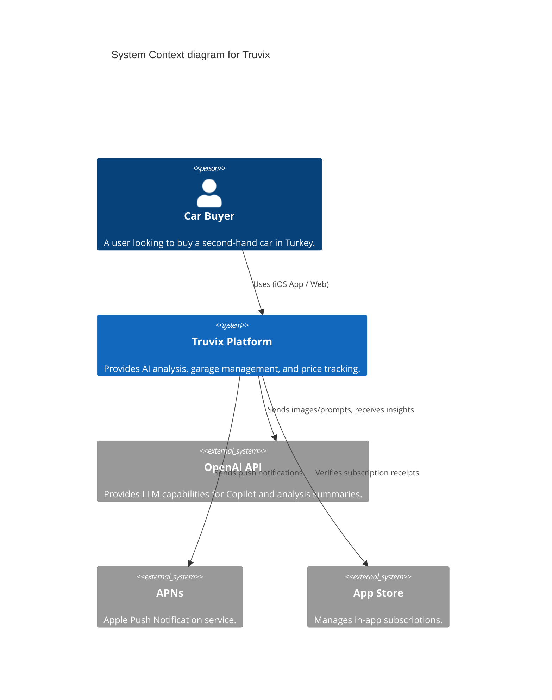

# Architecture Overview

## System Context Diagram



## Container Diagram

```mermaid
C4Container
  title Container diagram for Truvix

  Container(ios_app, "iOS Application", "Swift, SwiftUI", "Provides the native mobile experience.")
  
  Container_Boundary(backend, "Backend Modular Monolith") {
    Container(api, "API Layer", "FastAPI, Python", "Handles HTTP requests and JWT auth.")
    Container(ai_service, "AI Pipeline Service", "Python", "Orchestrates Vision and LLM models.")
    Container(notification_svc, "Notification Service", "Python", "Manages push and email notifications.")
  }

  ContainerDb(postgres, "PostgreSQL", "Relational Database", "Stores users, vehicles, and analyses.")
  ContainerDb(redis, "Redis", "In-Memory Cache", "Handles rate limiting and background job queues.")

  Rel(ios_app, api, "Makes API calls to", "JSON/HTTPS")
  Rel(api, postgres, "Reads from and writes to", "SQL/TCP")
  Rel(api, redis, "Uses for caching/rate limits", "RESP/TCP")
  Rel(api, ai_service, "Triggers analyses")
  Rel(ai_service, openai, "Calls Vision/LLM APIs", "HTTPS")
```

## Technology Decisions

| Component | Technology | Rationale |
| :--- | :--- | :--- |
| **Backend API** | FastAPI (Python) | High performance, async support, auto-generated OpenAPI docs. |
| **Database** | PostgreSQL | Strong relational integrity for financial and user data. |
| **Cache & Queue** | Redis | Fast rate-limiting, session management, and Celery backend. |
| **AI Models** | OpenAI GPT-4o | Best-in-class vision and reasoning capabilities. |
| **Mobile App** | SwiftUI | Modern declarative UI, fast iteration for iOS. |
| **Infrastructure** | Docker | Consistent environments across local and production. |

## Modular Monolith
The backend is designed as a Modular Monolith. Instead of splitting into microservices prematurely, we use logical modules (Auth, Vehicles, Analyses, Copilot) within a single deployed FastAPI application. This reduces operational complexity while maintaining clean boundaries for future extraction.

## AI Pipeline Flow
1. **Rule Engine:** Pre-validates images (e.g., ensuring it's actually a car).
2. **Vision Inspector:** Uses Vision models to detect scratches, dents, and part replacements.
3. **LLM Enrichment:** A reasoning model compiles findings into a cohesive summary in Turkish.
4. **Final Score:** A deterministic algorithm calculates the 0-100 Trust Score based on the severity of the findings.

## Security Architecture
- **Authentication:** Stateless JWT (JSON Web Tokens) with short expiry and refresh token rotation.
- **Passwords:** Hashed using Argon2id.
- **Mobile Storage:** Sensitive tokens stored securely in iOS Keychain.
- **Compliance:** Data minimized and anonymized before sending to OpenAI to comply with KVKK.

## Deployment Topology
- **Local:** Managed via Docker Compose (`docker-compose.yml`) containing API, Postgres, and Redis.
- **Production:** Containerized application deployed behind an Nginx reverse proxy with TLS termination.
