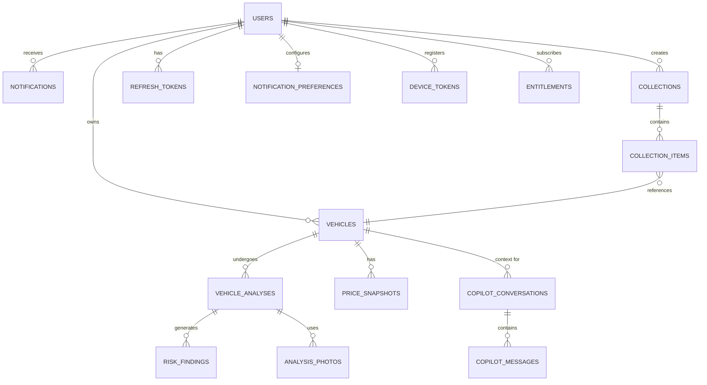

# Data Model

## Entity-Relationship Diagram

## Core Tables

### `users`
Stores user identities and authentication details.
- `id` (UUID, PK)
- `email` (VARCHAR, Unique)
- `password_hash` (VARCHAR, Argon2)
- `subscription_tier` (ENUM: free, premium)

### `vehicles`
Stores core vehicle metadata tracked by the user.
- `id` (UUID, PK)
- `user_id` (UUID, FK)
- `brand`, `model`, `year` (VARCHAR/INT)
- `price` (DECIMAL)
- `is_favourite` (BOOLEAN)

### `vehicle_analyses`
Records an AI analysis run on a specific vehicle.
- `id` (UUID, PK)
- `vehicle_id` (UUID, FK)
- `trust_score` (INT)
- `risk_level` (ENUM: low, medium, high)
- `summary` (TEXT)

### `risk_findings`
Specific issues found during an analysis.
- `id` (UUID, PK)
- `analysis_id` (UUID, FK)
- `severity` (ENUM: low, medium, high)
- `description` (TEXT)

## Key Indexes
- `idx_vehicles_user_id`: Optimize garage loading.
- `idx_price_snapshots_vehicle_date`: Fast retrieval of price history charts.
- `idx_users_email`: Unique constraint and fast login lookup.

## Data Lifecycle & Privacy
- **Retention:** User data is retained as long as the account is active.
- **Deletion:** A hard delete on a `users` record cascades to all owned entities (`vehicles`, `analyses`, etc.) ensuring KVKK right-to-be-forgotten compliance.
- **Third-Party Processing:** Images sent to OpenAI are not used for model training (per API terms) and are only retained transiently.
